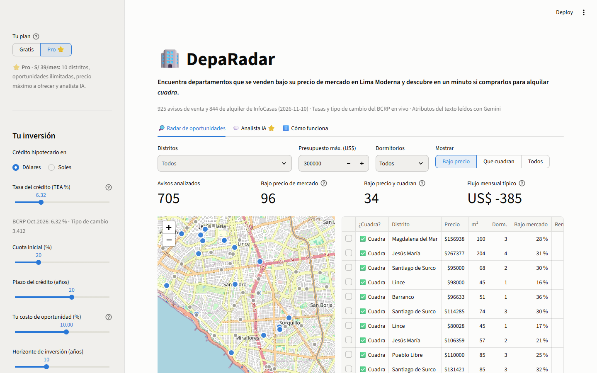
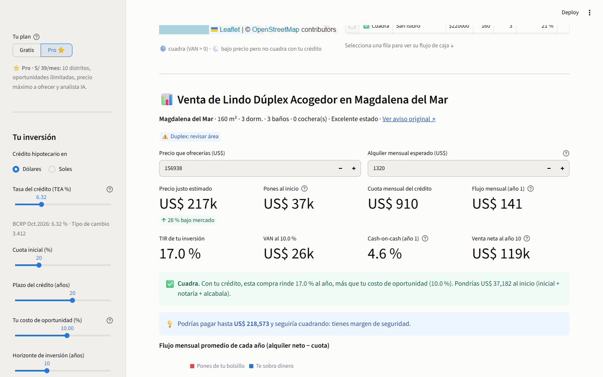
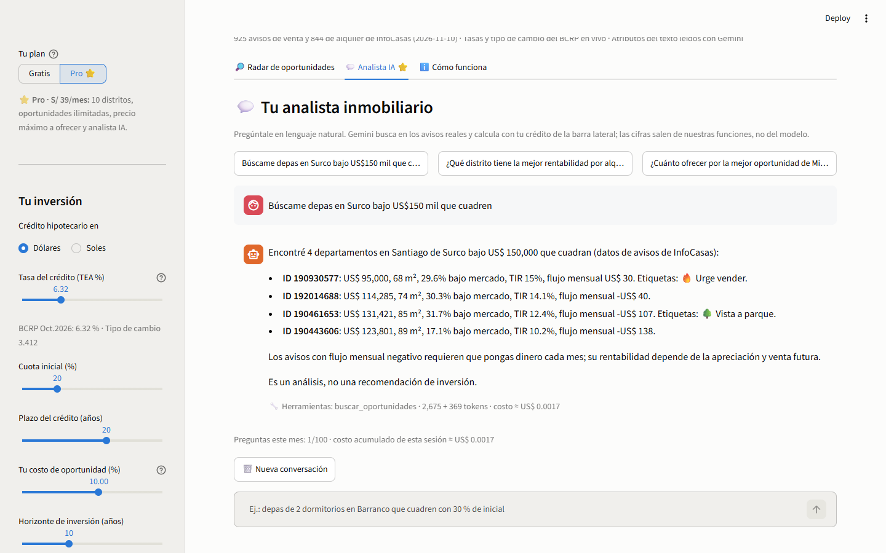
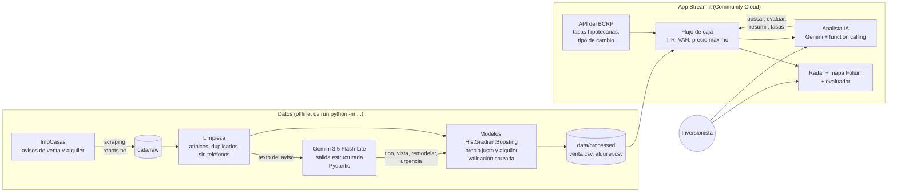

# 🏢 DepaRadar

> **Ayudamos a inversionistas inmobiliarios minoristas de Lima a encontrar departamentos que se venden bajo su precio de mercado y a saber en un minuto si comprarlos para alquilar *cuadra*, mediante avisos reales, *machine learning*, Gemini y las tasas hipotecarias del BCRP.**

**🔗 Demo en vivo: https://deparadar-bfoap3s6atcurghio2zl38.streamlit.app**

| 925 avisos de venta analizados | 130 bajo su precio de mercado | **39 que además cuadran** con un crédito al 6.3 % |
|:---:|:---:|:---:|

Proyecto final del curso *Data Science con Python* (Universidad del Pacífico, 2026-II).

---

## 1. One-liner
**Hacemos** un radar de oportunidades y un evaluador de flujo de caja **para** inversionistas inmobiliarios minoristas de Lima Moderna **mediante** avisos reales scrapeados, un modelo de precio justo, Gemini que lee cada aviso y las tasas hipotecarias del BCRP.

## 2. Founder
**Luis Felipe Abriojo Vargas** estudia Economía y Finanzas en la Universidad del Pacífico. Valorizar activos, proyectar flujos de caja y evaluar créditos es justo lo que aprende en la carrera, y el mercado inmobiliario es el activo donde más peruanos ponen sus ahorros, casi siempre sin hacer esos números. DepaRadar junta las dos cosas: finanzas para decidir y *data science* para encontrar las oportunidades.

<!-- TODO (Luis): agrega 1–2 frases personales: por qué te interesa el mercado inmobiliario o alguna experiencia propia/familiar. -->

## 3. Problema
**Quién lo sufre:** quien tiene US$30–60k ahorrados y quiere comprar 1 o 2 departamentos para alquilar en Lima.

**Cuánto le cuesta:** con los avisos reales de noviembre de 2026, el departamento mediano de Lima Moderna se pide en **US$182,852** y se alquilaría en ~US$769. Si se compra con 80 % de crédito a la tasa promedio del BCRP (6.32 %):

- el inversionista pone **US$505 de su bolsillo cada mes** (y US$43k al inicio);
- su inversión rinde **5.1 % al año**, menos que un costo de oportunidad de 10 %;
- solo cuadra si lo compra a **US$127,800**, o sea, **30 % menos** de lo que se pide.

Con esa misma estructura de crédito, **el 99 % de los avisos tiene flujo mensual negativo**. Pagar de más o elegir mal cuesta decenas de miles de dólares.

**Cómo lo resuelve hoy:** revisa portales (Urbania, Adondevivir, InfoCasas) que muestran precios pero no dicen si un aviso está caro ni si cuadra; hace números a mano en Excel o con el simulador del banco, que solo da la cuota; o confía en un corredor, que cobra comisión sobre el precio de venta.

**Conversaciones con usuarios potenciales:** notas en [`docs/research/`](docs/research/).

| # | Perfil | Estado |
|---|---|---|
| 1 | Profesor de Economía Financiera (experto en evaluación de inversiones) | _pendiente_ |
| 2 | Corredor inmobiliario de Lima Moderna | _pendiente_ |
| 3 | Inversionista minorista | _pendiente_ |

## 4. Solución e insight
DepaRadar hace en un minuto lo que a un inversionista le toma semanas:

1. **Radar:** lee los avisos reales de venta y alquiler de 10 distritos de Lima Moderna.
2. **Precio justo:** un modelo de *machine learning* (HistGradientBoosting) estima cuánto debería costar cada departamento según distrito, área, dormitorios, cocheras, estado, amenidades, ubicación exacta y lo que Gemini leyó del texto. Cada aviso se valora con un modelo que **nunca lo vio** (validación cruzada): error mediano de **10.2 %**, frente a 13.4 % si se usa solo la mediana del distrito.
3. **Alquiler estimado:** otro modelo, entrenado con 844 avisos de alquiler, estima cuánto rentaría cada departamento en venta.
4. **Flujo de caja peruano:** cuota hipotecaria, alcabala, notaría, vacancia, predial, impuesto a la renta del alquiler (5 %) y ganancia de capital (5 %), con las tasas del BCRP. Resultado: TIR, VAN y un veredicto de ✅ cuadra o ❌ no cuadra.
5. **Cuánto ofrecer:** el precio máximo al que la compra todavía cuadra. Es la cifra para negociar.
6. **Analista IA (plan Pro):** "búscame depas en Surco bajo US$150 mil que cuadren" → responde con avisos reales.

**Insights:**
- **"Barato" no es lo mismo que "rentable".** De 130 avisos bajo su precio de mercado, solo 39 cuadran con un crédito normal. El valor no está en listar avisos, sino en filtrar los que pasan los números.
- **Gemini no mejora la precisión, pero sí la explicación.** Los atributos que lee del texto no bajan el error del modelo; lo que hacen es explicar cada oportunidad: 30 de las 130 dicen "urge vender" (señal de que el descuento es real) y 23 son dúplex o tríplex (señal de cautela, porque el área puede incluir terrazas).
- **La urgencia de venta queda fuera del modelo a propósito.** Si el modelo aprendiera que los avisos "de ocasión" son más baratos, les bajaría el precio justo y escondería justo las gangas.

## 5. Why now
- **Leer y estructurar 1,769 avisos cuesta US$0.60** con Gemini 3.5 Flash-Lite y salidas estructuradas (medido: 385k tokens de entrada y 193k de salida). Hace tres años eso exigía analistas o modelos varias veces más caros.
- **El BCRP publica sus series en una API abierta**: tasas hipotecarias y tipo de cambio actualizados sin pagar un proveedor de datos.
- **Desplegar cuesta cero**: Streamlit Community Cloud sirve la app gratis, así que el costo por usuario es casi solo de tokens.
- **Tasas hipotecarias en ~6–7.5 %** (oct-2026): con crédito, la diferencia entre comprar bien y comprar caro decide si el flujo es positivo o negativo.

## 6. Demo
**URL pública:** https://deparadar-bfoap3s6atcurghio2zl38.streamlit.app

**Correrlo en local** (Python 3.11 y [uv](https://docs.astral.sh/uv/)):
```bash
uv sync
cp .env.example .env              # y pon tu GEMINI_API_KEY (solo para el analista IA)
uv run streamlit run app/streamlit_app.py
```

**Actualizar los datos:**
```bash
uv run python -m deparadar.scraping --max-paginas 5   # avisos de InfoCasas → data/raw/
uv run python -m deparadar.llm                        # Gemini lee los avisos nuevos (con caché)
uv run python -m deparadar.pipeline                   # limpieza + modelos → data/processed/
uv run pytest                                         # 22 tests
```

### Capturas
**Radar:** mapa, embudo y oportunidades ordenadas por veredicto y TIR.


**Evaluador:** precio justo, flujo de caja, TIR, VAN y cuánto ofrecer.


**Analista IA:** Gemini con *function calling* sobre nuestros datos, con el costo de cada respuesta.


### Arquitectura


### Modelos y APIs, y por qué
| Componente | Qué usamos | Por qué |
|---|---|---|
| Lectura de avisos | **Gemini 3.5 Flash-Lite** con `response_schema` (Pydantic) | El más barato de la familia con buena calidad en español; JSON validado, sin parsear texto. Respaldo automático a otros modelos si responde 503 o 429. |
| Analista IA | **Gemini 3.5 Flash-Lite** con *function calling* manual | El modelo elige herramientas y redacta; **las cifras salen de Python**, así no inventa precios ni tasas. Sumamos los tokens de cada paso para medir el costo. |
| Precio justo y alquiler | **HistGradientBoosting** (scikit-learn) sobre log(US$/m²) | Captura no linealidades (ubicación × área), acepta valores faltantes y variables categóricas, y entrena en segundos. |
| Tasas y tipo de cambio | **API del BCRP** (PN07848NM, PN07857NM, PD04638PD) | Fuente oficial y gratuita; caché local para que el demo no dependa de la red. |
| Mapa | **Folium** + OpenStreetMap | Mapa interactivo con *tooltips*, sin clave. |
| Despliegue | **Streamlit Community Cloud** | Gratis y se actualiza solo con cada *merge* a `main`. |

## 7. Modelo de negocio
**Quién paga:** el inversionista minorista. Una sola negociación guiada por DepaRadar puede ahorrarle miles de dólares.

| Plan | Precio | Incluye |
|---|---|---|
| Gratis | S/ 0 | 1 distrito, las 3 mejores oportunidades, evaluador básico |
| **Pro** | **S/ 39/mes** | 10 distritos, oportunidades ilimitadas, precio máximo a ofrecer, analista IA, alertas |
| Informe suelto | S/ 19 | PDF del análisis de un depa |

**Costo por usuario Pro al mes** (precios de Gemini 3.5 Flash-Lite: US$0.30 por millón de tokens de entrada y US$2.50 por millón de salida):

| Concepto | US$/usuario/mes |
|---|---|
| Gemini lee avisos nuevos (US$0.60 por dataset completo, compartido) | 0.005 |
| Analista IA (~US$0.002 por pregunta medido en la app × 100) | 0.27 |
| Servidor (con 100 usuarios, ~US$25/mes) | 0.25 |
| Pasarela de pago (~4 %) | 0.45 |
| **Total** | **≈ 0.98** |

Ingreso neto: S/ 39 ÷ 1.18 (IGV) ÷ 3.43 = **US$9.64** → **margen bruto ≈ 90 %**. El plan Gratis/Pro se puede probar en la app (es simulado: no se cobra). Detalle en [`docs/modelo-negocio.md`](docs/modelo-negocio.md).

## 8. Herramientas del curso
| Herramienta | Sesión | Dónde está | Para qué |
|---|---|---|---|
| **Scraping y APIs** | 03 | [`src/deparadar/scraping/infocasas.py`](src/deparadar/scraping/infocasas.py) | Datos reales de 1,893 avisos sin pagar a un proveedor |
| **API del BCRP** | 04 | [`src/deparadar/bcrp.py`](src/deparadar/bcrp.py) | Tasas hipotecarias y tipo de cambio oficiales; series buscadas con el catálogo de metadatos, como en la sesión |
| **Mapas con Folium** | 06 | [`app/streamlit_app.py`](app/streamlit_app.py) | Ver dónde están las oportunidades que cuadran |
| **LLMs con salidas estructuradas** | 08 | [`src/deparadar/llm.py`](src/deparadar/llm.py) | Extraer del texto lo que la ficha no dice |
| **Agentes** (*function calling*) | 11 | [`src/deparadar/agente.py`](src/deparadar/agente.py) | Analista que busca y evalúa con nuestras funciones |
| **Despliegue y evaluación** | 12 | Streamlit Cloud · [`tests/`](tests/) | URL pública; 22 tests y validación cruzada del modelo |

**Por qué estas:** el problema necesita **datos reales** (scraping), **costo del dinero real** (BCRP) y **leer lenguaje natural** (Gemini). El mapa y el analista son la forma en que el usuario consume todo eso.

## 9. Qué hizo el agente
DepaRadar se construyó con **Claude Code** (Claude Opus 5.5) como pareja de programación, trabajando con ramas `feature/*` y *pull requests*.

**Lo que generó Claude Code:** la estructura del proyecto (uv, `.gitignore`, `.env.example`), el scraper y sus tests, la limpieza, los modelos con validación cruzada, el motor de flujo de caja (y su versión con numpy), el cliente del BCRP, la extracción con Gemini, el agente con *function calling*, la app de Streamlit, el script de capturas y este README.

**Lo que decidió y verificó el founder:** el problema y el cliente; el alcance (Lima Moderna, compra para alquilar; remates y terrenos al roadmap); el modelo de negocio y el precio; qué herramientas usar; y la revisión y aprobación de cada *pull request*.

**Errores que encontramos probando** (y que se corrigieron con su test o verificación):
- teléfonos de corredores dentro de las descripciones, que se iban a publicar en el repo;
- "gangas" que en realidad eran dúplex con terrazas;
- la sugerencia de precio máximo comparaba contra el precio pedido y no contra el ofrecido;
- Streamlit mostraba como fórmulas LaTeX los textos con dos montos en dólares;
- el ranking tardaba ~4.5 s (pasó a ~1.3 s).

---

### Roadmap
Alertas por correo o WhatsApp · informe PDF · más portales y ciudades (Arequipa, Trujillo) · remates judiciales y bancarios (Document AI) · evaluación de terrenos · comisiones por referir créditos hipotecarios.

### Riesgos
- **Una sola fuente de datos:** InfoCasas. Urbania y Adondevivir bloquean el acceso automático.
- **Precios pedidos, no de cierre:** el descuento real se confirma negociando.
- **Error del modelo de ~10 %:** por eso exigimos 15 % de descuento para hablar de oportunidad.
- **No es asesoría financiera:** verifica siempre el inmueble, la partida registral y los números con un profesional.

### Datos y privacidad
Solo se leen páginas de búsqueda que el `robots.txt` permite, con pausas entre pedidos. No se guardan nombres ni teléfonos de anunciantes (lo verifica un test), y la limpieza borra teléfonos, correos y enlaces de WhatsApp del texto.

### Licencia
[MIT](LICENSE)
